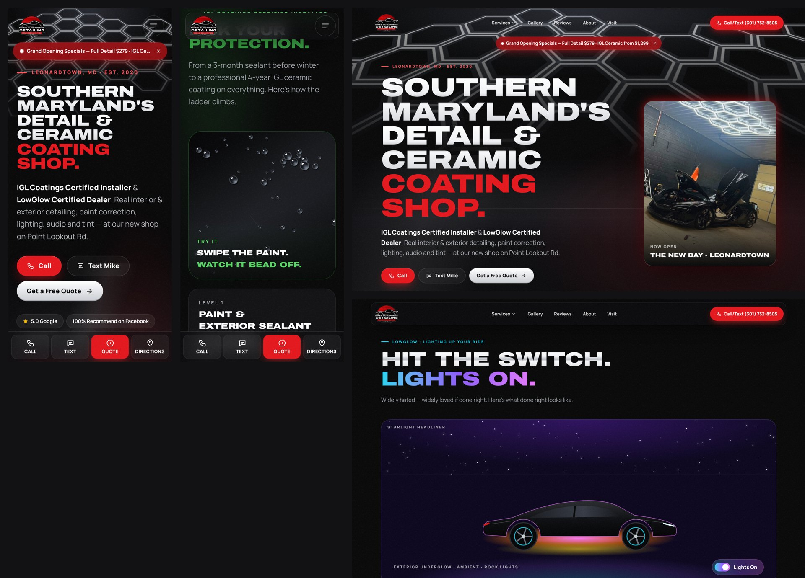

# Mike's Automotive Detailing — website

Marketing site for **Mike's Automotive Detailing** (Leonardtown, MD). Built with Next.js 16 (App Router), TypeScript, Tailwind CSS 4, Framer Motion and Lenis. Hosted on Vercel; every push to the connected branch deploys automatically.

```
content/site.ts      ← ALL words, prices, promos, hours, reviews, FAQ, gallery captions (edit this)
content/images.generated.ts  ← image sizes + blur placeholders (auto-generated, don't edit)
app/                 ← pages (one folder per URL) + /api/quote
components/          ← UI sections, effects (hex lights, water beading, Lights On, equalizer)
lib/                 ← time logic (open now / promos), SEO + schema helpers
scripts/process-images.mjs  ← photo pipeline (crop, grade, plate blur, AVIF/WebP)
tests/time.test.mts  ← tests for "Open now" and promo expiry
```

## How to edit content (no coding needed)

Open **`content/site.ts`** on GitHub, click the pencil, change the text, and commit. Vercel rebuilds in about a minute.

| To change… | Look for |
|---|---|
| Phone, email, address, socials | `business` |
| Online booking link | `BOOKING_URL` at the top (leave `""` and "Book Online" opens the quote form) |
| Hours | `hours` (used for Open now/Closed) **and** `hoursDisplay` (the text people see) |
| Prices | `prices` (full detail, ceramic "from" price, tint removal) |
| Specials / promos | `promos` — each has `startsAt` / `endsAt`. They show automatically inside those dates and hide themselves after. |
| Google / Facebook rating numbers | `ratings` |
| Reviews | `reviews` — real quotes only; trim with "…", never change words |
| Gallery captions | `gallery` |
| FAQ | `faqs` (home) and each service's `faqs` |
| Mobile/on-site service answer | `business.offersMobileService` (`true`, `false` or `null`) |
| Footer credit | `business.websiteCredit.show` → `false` to remove |

**Testing a promo date:** add `?previewDate=2026-12-01` to any URL to see the site as it would look on that day (promo banner/cards and the Open now badge use it).

## Environment variables (Vercel → Project → Settings → Environment Variables)

| Name | Required | What it does |
|---|---|---|
| `RESEND_API_KEY` | For email quotes | API key from resend.com. **Without it, the quote form still works**: it shows a one-tap "text my quote to Mike" fallback with everything pre-filled. |
| `QUOTE_TO_EMAIL` | Optional | Where quotes go. Defaults to `mike_tippett4815@icloud.com`. |
| `QUOTE_FROM_EMAIL` | Recommended | Verified sender, e.g. `Mike's Website <quotes@yourdomain.com>`. Until a domain is verified in Resend, the default `onboarding@resend.dev` sender can only deliver to the Resend account owner's own email. |
| `NEXT_PUBLIC_SITE_URL` | Once a domain is live | e.g. `https://mikesautomotivedetailing.com` — used for canonical URLs, sitemap, and schema. |

Analytics: enable **Web Analytics** in the Vercel project (Analytics tab). The site tracks clicks on Call, Text, Email, Directions, Quote buttons, quote submits, socials and promo banners (`data-track` attributes).

## Developing

```bash
npm install
```

```bash
npm run dev
```

```bash
npm run build && npm run lint && npm run typecheck && npm test
```

### Photos

Original phone photos live in `.raw-photos/` (git-ignored — they contain unblurred license plates and flyer text, so they are never committed or served). To re-process after changing a crop/blur box in `scripts/process-images.mjs`:

```bash
npm run images
```

What the pipeline does: honours EXIF rotation, pixelates + blurs every readable plate **before** anything else, straightens the shop photo, crops out baked-in watermarks/flyer text, applies one consistent "night in the bay" grade (lifted blacks, cooler shadows, richer reds), and writes AVIF + WebP at 480/768/1200/1600 (never upscaled past the original), plus a tiny blur placeholder. The logo gets its white background knocked out into a transparent PNG and favicons.

How each Drive photo is used:

| # | Photo | Used as |
|---|---|---|
| 01 | Logo | Nav, footer, favicon/app icons, schema logo (transparent PNG) |
| 02 | Mike + C8 flyer | Text-free crops: `mike-polisher-c8` (About / Paint Correction / process step 4), `c8-mike-wide` (spare) |
| 03 | GMC AT4X | Ceramic page hero, gallery, process step 6, fleet page (plate blurred) |
| 04 | Jeep Gladiator | Gallery, process step 2 (cropped, plate blurred) |
| 05 | Ford Explorer | Auto Detailing hero, gallery, process step 3 (plate blurred) |
| 06 | Z06 frunk/engine bay | Lighting hero, gallery |
| 07 | LowGlow flyer | Reference only — rebuilt natively as the Lighting section. Its thumbnails were AI-style renders with baked-in labels, so they were not used. |
| 08 | Z06 foam | Process step 1, gallery (watermark cropped) |
| 09 | Monte Carlo gloss | Gallery, process step 5 (watermark cropped) |
| 10 | Mike pressure washing | About / Meet Mike, gallery (watermark cropped, background truck blurred) |
| 11 | Chevy Trax | Gallery (caption + watermark cropped, plate blurred) |
| 12 | Tacoma | Small gallery tile, Tint page (plate + watermark cropped out) |
| 13 | Shop hex lights | Home hero card, Visit the Shop, Audio page, gallery (straightened 11°) |
| 14 | Grand opening flyer | Reference only — rebuilt as the native Specials component |

### Shop map

The map in "Visit the Shop" is a custom drawing, not a Google embed: `scripts/build-map.mjs` downloads the streets around the shop from OpenStreetMap (cached in the git-ignored `.osm/` folder) and writes `public/images/map/shop-map.svg` — dark ground, glowing roads, Point Lookout Rd (MD 5) lit up, the shop at the exact centre. The "Directions" button still opens Google Maps. To redraw it (e.g. after changing colours in the script):

```bash
npm run map
```

## What's on the site

- **Home:** hex-light power-on hero → certifications → live specials → 6 service cards → ceramic protection ladder with the water-beading demo → pinned 6-step process → recent work → reviews → Meet Mike → quote builder → Visit the Shop (live Open now/Closed in Eastern time, custom night map) → FAQ → "Because Detail Matters" CTA.
- **Service pages:** `/auto-detailing`, `/ceramic-coating`, `/paint-correction`, `/lighting`, `/car-audio`, `/window-tint`, `/fleet` — each with hero, signature feature, what's included, who it's for, pricing, proof + matching reviews, FAQ (with FAQ schema), and a quote form pre-selected for that service.
- `/gallery` (filter + lightbox), `/reviews`, `/about`, `/contact`, `/privacy`, and a 404 where the hex lights flicker out.
- **SEO:** `AutomotiveBusiness` JSON-LD on every page (address, geo, hours, area served, socials, credentials, offer catalog), `FAQPage` and `BreadcrumbList` schema, per-page titles/descriptions/canonicals, `sitemap.xml`, `robots.txt`, `llms.txt`, Open Graph image, favicons. `aggregateRating` is only output once the Google review count is filled in `ratings.google.reviewCount`.
- **Quote form:** 4 animated steps, up to 5 photos (compressed in the browser), honeypot + timing check + rate limit, emails via Resend, SMS fallback.

## Quality checks (Nov 10, 2026)



**Lighthouse, mobile, live site** (Performance / Accessibility / Best Practices / SEO). Performance varies a few points run to run; ranges show repeated runs.

| Page | Scores | LCP | CLS |
|---|---|---|---|
| `/` | 93–99 / 100 / 100 / 100 | 1.1 s | 0 |
| `/auto-detailing` | 96–99 / 100 / 100 / 100 | 0.9–1.1 s | 0 |
| `/ceramic-coating` | 98–100 / 100 / 100 / 100 | 1.1 s | 0 |
| `/paint-correction` | 98 / 100 / 100 / 100 | 1.1 s | 0 |
| `/lighting` | 100 / 100 / 100 / 100 | 1.1 s | 0 |
| `/car-audio` | 100 / 100 / 100 / 100 | 1.1 s | 0 |
| `/window-tint` | 100 / 100 / 100 / 100 | 1.1 s | 0 |
| `/fleet` | 100 / 100 / 100 / 100 | 1.1 s | 0 |
| `/gallery` | 93–95 / 100 / 100 / 100 | 2.5 s | 0 |
| `/reviews` | 99 / 100 / 100 / 100 | 0.9 s | 0 |
| `/about` | 96 / 100 / 100 / 100 | 2.7 s | 0 |
| `/contact` | 100 / 100 / 100 / 100 | 1.0 s | 0 |
| `/privacy` | 98 / 100 / 100 / 100 | 0.9 s | 0 |

Also verified: zero TypeScript/ESLint errors, no console errors, no horizontal overflow at 375/390/768/1024/1440/1920, 13 passing unit tests (Eastern-time open/closed incl. DST, promo windows), promo auto-hide with `?previewDate`, quote API guards (honeypot, validation, rate limit, not-configured → SMS fallback), and the full 4-step quote flow in a real browser.

## [CONFIRM] list for Mike

Everything below is already wired up — just update `content/site.ts` once Mike confirms.

1. **Booking URL** — exact Koalendar link behind the Facebook "Book now" button → `BOOKING_URL`.
2. **Ceramic starting price** — site says IGL packages start at **$1,500** (an older post said $800) → `prices.ceramicFrom`.
3. **Promo dates** — Grand Opening assumed to run **Oct 24 → Nov 21, 2026** (4 weeks); Fall Exterior Special $100 assumed to run through **Nov 30, 2026**. Is the Fall special still running? → `promos[].startsAt / endsAt`.
4. **Travel / mobile service** — still offered now that the shop is open? → `business.offersMobileService`.
5. **LowGlow dealer link or code** → `business.lowglowUrl` / `business.lowglowCode`.
6. **IGL warranty terms** — not stated anywhere on the site yet (we don't publish warranties without confirmation).
7. **Audio and tint brands** he carries — not listed yet.
8. **Google review count + exact review link** (`g.page/r/…`) → `ratings.google.reviewCount`, `links.googleReviews`. Unlocks star-rating schema.
9. **Domain** — set `NEXT_PUBLIC_SITE_URL` (and `business.siteUrl`) to the real domain.
10. **Shop photo car** — photo 13 is captioned without naming the car model; confirm what it is if he wants it named.
11. **Underglow photo** — the C8 Z06 underglow gallery tile uses a drawn illustration (clearly labelled) until Mike sends a real photo of the install.
12. **Official IGL / LowGlow dealer badges** — site uses tasteful text badges; swap in official assets if he has them.

---

Website by Lee Enterprises Unlimited.
